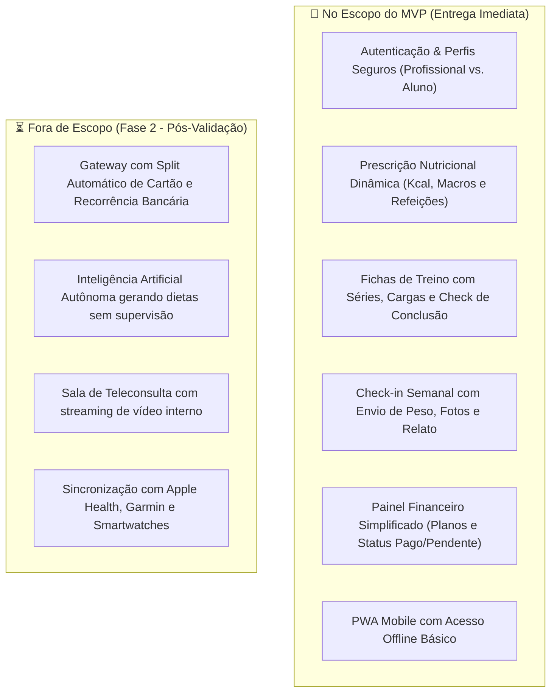

# PROPOSTA EXECUTIVA: LANÇAMENTO DO MVP REAL FIT HUB
**Documento de Alinhamento de Produto e Estratégia para Liderança**  
*Data: Outubro de 2026 | Versão: 1.0 (MVP) | Classificação: Estratégico / Interno*

---

## 1. Sumário Executivo

### 1.1 A Oportunidade de Mercado
O mercado de consultoria de saúde e fitness (nutrição e treinamento personalizado) vive uma contradição: a demanda por acompanhamento individualizado nunca foi tão alta, mas a operação dos profissionais continua extremamente analógica e ineficiente.

A rotina atual de nutricionistas e personal trainers apoia-se em:
* Prescrições manuais dispersas em PDFs e planilhas de Excel.
* Atendimento e cobrança desorganizados via WhatsApp.
* Falta de visibilidade contínua sobre a real adesão do paciente à rotina.

**Resultado:** Profissionais gastam mais de 40% do tempo em rotinas operacionais em vez de captar e reter clientes; pacientes abandonam o acompanhamento pela falta de praticidade e feedback rápido.

### 1.2 A Solução: Real Fit Hub
O **Real Fit Hub** é uma plataforma SaaS integrada (Web & PWA) projetada para unificar o fluxo de ponta a ponta:
1. **Para o Profissional:** Painel administrativo executivo para prescrição acelerada de dietas e treinos, controle de pagamentos/mensalidades e análise de check-ins.
2. **Para o Aluno/Paciente:** Aplicativo leve (PWA) de acesso imediato no celular para consultar a rotina do dia, registrar treinos feitos e enviar dados de evolução em menos de 2 minutos.

---

## 2. Impacto Estratégico e Métricas de Sucesso (KPIs)

Este MVP não visa apenas validação conceitual, mas sim impacto operacional direto e geração de valor mensurável nos primeiros **90 dias**:

| Indicador Estratégico | Situação Atual (Sem Plataforma) | Meta com o MVP (90 dias) | Impacto no Negócio |
| :--- | :--- | :--- | :--- |
| **Tempo de Prescrição (Time-to-Protocol)** | 40 a 60 min por plano | **$\le 15$ minutos** | Aumento da capacidade de atendimento do profissional em mais de 2.5x. |
| **Adesão ao Check-in Semanal** | $\approx 30\%$ via WhatsApp | **$\ge 70\%$ no PWA** | Prevenção de abandono (churn) através de contato proativo. |
| **Ativação da Base** | N/A | **$\ge 65\%$** | Validação de que novos usuários montam protocolos e convidam alunos em até 48h. |
| **Controle de Inadimplência** | Cobrança manual e reativa | **Visibilidade em tempo real** | Redução de atrasos nos pagamentos de planos de consultoria. |

---

## 3. Escopo Cirúrgico do MVP (O que entra vs. O que fica para a v2)

Para garantir **velocidade de entrega**, **baixo custo de desenvolvimento** e **rápido retorno sobre o investimento (ROI)**, o escopo foi rigorosamente priorizado:



### Por que esta divisão protege o caixa da empresa?
* **Sem complexidade regulatória bancária no Dia 1:** O controle de mensalidades utiliza status direto e PIX manual com chave do profissional, eliminando a dependência de contratos bancários complexos e taxas de adquirente antes de atingirmos volume.
* **Foco no valor essencial:** Validamos primeiro o hábito de uso diário (adesão do paciente ao treino e à dieta) antes de investir em integrações caras com hardware ou automações pesadas.

---

## 4. Viabilidade Técnica, Segurança e Conformidade (LGPD)

A arquitetura foi desenhada para ter custo de infraestrutura próximo de zero no lançamento, com alta capacidade de escala.

### 4.1 Pilares Técnicos
1. **Frontend Leve e Ágil:** PWA com Tailwind e JavaScript, garantindo carregamento instantâneo em qualquer smartphone (iOS e Android), sem a fricção e burocracia de publicação em lojas de aplicativos (App Store / Play Store).
2. **Backend Robusto (Supabase / PostgreSQL):**
   * Banco de dados relacional performático com controle nativo de permissões.
   * Armazenamento seguro de imagens de check-ins.
3. **Modo Offline:** Capacidade do aluno consultar sua dieta e ficha de treino na academia mesmo sem sinal de internet móvel.

### 4.2 Blindagem Jurídica e Proteção de Dados (LGPD)
Dados de saúde, medidas corporais e fotos de avaliação física são **dados sensíveis** (Art. 5º da LGPD). A arquitetura contempla:
* **Row-Level Security (RLS):** Cada profissional e cada aluno só enxergam estritamente os seus próprios dados no banco de dados.
* **Armazenamento Criptografado e URLs com Expiração:** Fotos de evolução não ficam públicas na internet; o acesso ocorre exclusivamente através de links assinados e temporários.
* **Termos de Consentimento:** Aceite explícito do paciente no primeiro acesso para processamento de dados antropométricos.

---

## 5. Matriz de Riscos e Planos de Mitigação

| Risco | Nível | Impacto | Plano de Mitigação |
| :--- | :---: | :---: | :--- |
| **Resistência do profissional em mudar de ferramenta** | Médio | Alto | Interface intuitiva com presets/modelos de refeições prontas para que o profissional monte a primeira dieta em menos de 10 minutos. |
| **Upload lento de fotos travando o check-in no celular** | Alto | Médio | Compressão automática de imagens no próprio navegador do aluno antes do upload, economizando 80% dos dados móveis. |
| **Vazamento de dados ou falha de isolamento de pacientes** | Baixo | Crítico | Aplicação rigorosa de políticas RLS no banco e auditoria de chamadas de API antes do lançamento público. |

---

## 6. Cronograma Estimado de Execução

```
[Semana 1-2] Design & Fluxos Críticos
├── Refinamento das telas do profissional e do PWA do aluno
└── Aprovação do protótipo navegável com nutricionista parceiro

[Semana 3-5] Desenvolvimento dos Módulos Centrais
├── Autenticação, Banco de Dados e Políticas de Segurança (RLS)
├── Módulo de Dieta, Treinos e Check-in com upload otimizado
└── Painel Financeiro e Dashboard do Profissional

[Semana 6] Testes Integrados, Segurança & Piloto Controlado
├── Homologação com 3 a 5 profissionais convidados e seus alunos
└── Ajustes finos de usabilidade e performance

[Semana 7] Lançamento Oficial do MVP (Go-To-Market)
└── Onboarding dos primeiros clientes pagantes
```

---

## 7. Decisão Solicitada à Liderança

Para darmos início imediato ao desenvolvimento do MVP conforme o escopo e cronograma apresentados, solicitamos a aprovação para:
1. **Aprovação do Escopo do MVP:** Foco nos módulos essenciais de Prescrição, Check-in, PWA e Dashboard Executivo.
2. **Liberação do Ambiente de Homologação:** Configuração final das instâncias de banco de dados e repositório.
3. **Início do Piloto Beta:** Autorização para recrutar 3 profissionais parceiros para validação prática no final do ciclo.
